# 💫 About Me

Hey! I'm **Denim**, a B.Tech Computer Science student who enjoys building useful software and learning by shipping projects. I’m especially interested in **AI, mobile development, backend systems, and cloud technologies**.

- 🔭 Currently building and improving real-world software projects
- 🌱 Learning more about AI integration, backend engineering, and cloud
- 💬 Happy to talk about project ideas, app development, and problem-solving
- 🤝 Open to learning opportunities and collaborating on interesting projects

---

# 🚀 Projects

| Project | What it does |
| --- | --- |
| **[ProofFlow](https://github.com/Denim05/ProofFlow)** | An AI-powered evidence evaluation platform focused on organizing and assessing case evidence. |
| **[Sistec Chalo](https://github.com/Denim05/Minor-SistecChalo)** | A college shuttle tracking project for bus routes and tracking information. |
| **[AI Assistant for Education](https://github.com/Denim05/Smart-AI-Assistant-for-Education-01)** | An education-focused AI project exploring technology-supported learning. |

---

# 🛠️ Tech Stack

### Languages

### Frameworks & Development

### Databases & Tools

---

# 📊 GitHub Stats

 

 

---

# 🏆 GitHub Trophies

---

**Thanks for visiting my profile!** ⭐  
Feel free to explore my repositories.

